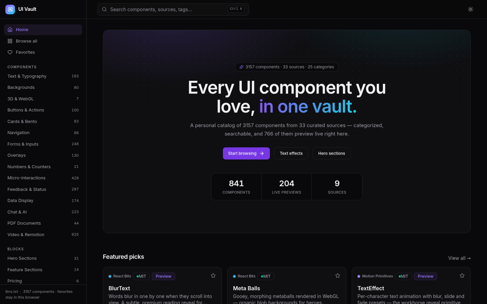

# UI Vault

**One searchable catalog of free, copy-pasteable React components from 33 open-source libraries.**

[**Open the live catalog →**](https://sanketpatel32.github.io/ui-vault/)

3157 components · 25 categories · 33 sources · 766 live previews

## What it does

- **Find** — fuzzy search (<kbd>Ctrl</kbd>/<kbd>⌘</kbd> <kbd>K</kbd>) and filters by category, source, license and tag; filters live in the URL so views are shareable.
- **Preview** — 766 components render live on their detail page (lazy-loaded, reduced-motion aware); every entry shows its license, source link and install command.
- **Reuse** — copy the install command, star favorites (stored in your browser), or feed the generated [`llms.txt`](https://sanketpatel32.github.io/ui-vault/llms.txt) to an AI agent.

## Sources

33 free, vendorable libraries — including React Bits, shadcn/ui, Magic UI, Aceternity UI (free tier), Animata, Animate UI, COSS UI and assistant-ui.

Where to find the full list

- On the site: every source has its own page, linked from the sidebar.
- As text: [`llms.txt`](https://sanketpatel32.github.io/ui-vault/llms.txt) lists each source with its license and entry count.
- In code: [`src/data/sources.ts`](src/data/sources.ts). Licensing per source is in [`AGENTS.md`](AGENTS.md#sources--licensing-researched-2026-08-29).

Only sources with free code and an install command are included. Paid, gated or gallery-only sources are left out on purpose.

## Commands

| Command                  | What it does                                             |
| ------------------------ | -------------------------------------------------------- |
| `npm install`            | Install dependencies (first time)                        |
| `npm run dev`            | Start the dev server (regenerates `llms.txt` first)      |
| `npm run build`          | Typecheck and build for production into `dist/`          |
| `npm run check`          | Format, lint and typecheck (`vp check`)                  |
| `npm test`               | Run unit tests (Vitest)                                  |
| `npm run llms`           | Regenerate the `public/llms*` files from `src/data/`     |
| `npm run registry:check` | Validate registry ids, categories, sources and licensing |

## Deploy

Every push to `main` builds and publishes the site to GitHub Pages via [`.github/workflows/deploy.yml`](.github/workflows/deploy.yml). It is a static SPA with no backend: to host it elsewhere, run `npm run build` and serve `dist/` with a fallback to `index.html`.

## Contributing

The catalog is TypeScript data in [`src/data/`](src/data/); the UI is only a view over it. Read [`AGENTS.md`](AGENTS.md) and [`CONTRIBUTING.md`](CONTRIBUTING.md) before adding a component.

Built with [Vite+](https://viteplus.dev), React 19, TypeScript, Tailwind CSS v4, Motion and fuse.js.
